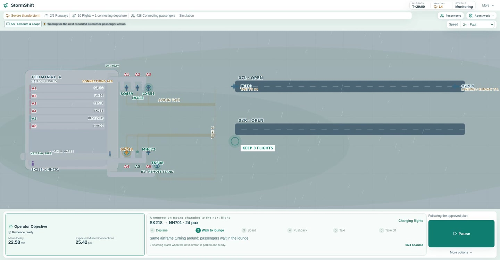
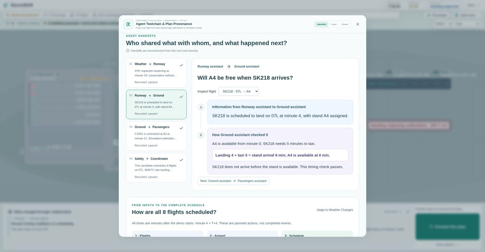
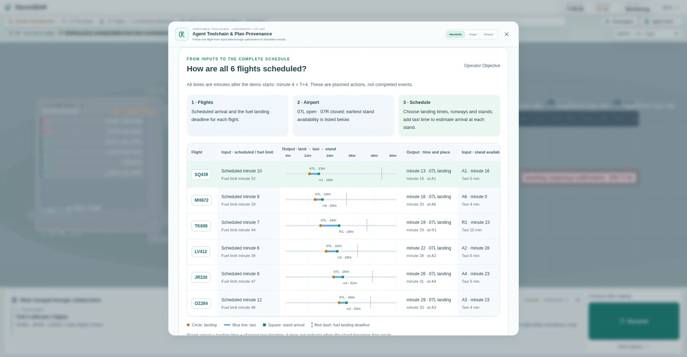

# StormShift

**一个可以看见完整过程的机场调度演示：暴雨发生、重新排班、人工批准，再到飞机滑行和旅客登机。**

[English](README.md) · [英文 2 倍速录像](https://github.com/Nuerjibieke/StormShift/releases/download/v2.0.0/stormshift-demo-en-2x.mp4) · [配置说明](docs/configuration.md) · [服务器部署](docs/deployment.md)

默认故事发生在暴雨晚高峰：07R 跑道关闭，一个机位仍被占用，8 架进港飞机需要重新安排落地时间、跑道和机位。执行途中，牵引车发生故障，系统重新安排尚未执行的航班。画面还会跟随 24 名从 SK218 转乘 NH701 的旅客，展示候机、登机、推出和起飞。

场景和旅客记录由程序生成，供研究与教学展示使用。

## 可以看到什么

- **输入与完整时间表**：每架飞机的预计到达时间、燃油限制、机位条件，以及最终的落地、滑行和入位安排。
- **Agent 之间的信息传递**：谁把哪架飞机的几点到达、哪个机位的信息交给谁；接收方检查了什么，接着做什么。页面消息来自本次运行记录的工具结果。
- **三份候选方案**：比较预计延误和错过转机人数，再选择方案。
- **人工批准与执行**：批准后开始执行计划，飞机和旅客在机场地图上运动。
- **途中故障与重新排班**：保留已经发生的动作，只调整后续安排。
- **保存与回放**：查看执行事件，回到较早的现场记录。
- **中英文界面**：可在大厅或演练中切换。

## Agent 和算法分别负责什么

| 部分 | 具体工作 |
| --- | --- |
| 天气、跑道助手 | 提供天气、预计开放时间和跑道限制 |
| 地勤、旅客助手 | 检查飞机到达时机位是否可用、转机时间是否足够 |
| 协调和安全检查 | 整理条件，检查燃油截止时间、资源冲突和批准要求 |
| **OR-Tools CP-SAT** | 把这一轮待安排的飞机放在一起计算，输出落地时间、跑道和机位 |
| SimPy 等仿真工具 | 在候选安排下估计延误、等待和错过转机的情况 |

**默认使用规则助手，不需要 GPU、模型权重或 API Key。** 可选接入本地大模型，用于结构化分析和理解操作意图；可执行的航班安排仍由 CP-SAT 计算。

## 安装和启动

以下步骤面向 Linux。先准备 Git、**Python 3.10**、**Node.js 22.12 或更新版本**，以及 [uv](https://docs.astral.sh/uv/getting-started/installation/)。

~~~bash
git clone https://github.com/Nuerjibieke/StormShift.git
cd StormShift

uv venv --python 3.10 .venv
uv pip sync --python .venv/bin/python requirements-lock.txt

npm --prefix frontend ci
npm --prefix frontend run build

cp .env.example .env
set -a
source .env
set +a

.venv/bin/python main_v2.py --host 127.0.0.1 --port 8080
~~~

打开 **[http://127.0.0.1:8080](http://127.0.0.1:8080)**。前台运行时，按 **Ctrl+C** 停止。

Python 和 npm 都提供依赖锁文件。前端构建后由 Python 服务统一提供页面、API 和 WebSocket，无需另开 Vite 服务。所有命令均从项目根目录执行；新终端启动时，需要重新加载环境变量。

如果程序运行在远程服务器，在自己的电脑另开终端建立转发：

~~~bash
ssh -N -o ExitOnForwardFailure=yes -o ServerAliveInterval=30 \
  -L 127.0.0.1:8080:127.0.0.1:8080 user@your-server
~~~

保持连接后访问上述本地地址。后台运行、systemd、日志和停止命令见[部署说明](docs/deployment.md)。

检查服务：

~~~bash
curl --fail http://127.0.0.1:8080/api/v2/health
~~~

默认模式中，API、SQLite 和 optimizer 应显示 `ready`；模型显示 `fallback`、语音显示 `disabled`。整体显示 `degraded` 可以是可选组件未启用的结果，不影响合成场景演示。

## 推荐演示顺序

1. 选择界面语言，进入暴雨演练，可将动画速度设为 **2×**。
2. 输入操作目标，例如优先照顾转机旅客，确认程序理解出的要求。
3. 启动分析与安全求解，查看候选方案。
4. 在 Agent 简报中打开完整记录；若简报已关闭，先打开 Agent 工作面板。检查具体信息传递，并查看全部 8 架进港飞机的排班表。
5. 预演并选择方案，在允许批准时确认执行。录像中选择的是 **Adapt to Weather Changes**。
6. 在 **T+9** 牵引车故障处查看受影响飞机和新时间表，讲解暂停后继续。若新方案要求人工批准，先查看并批准。
7. 观察旧飞机先离位、新飞机再进机位，以及 NH701 的旅客登机、推出和起飞，最后查看结果与回放。

**T+9** 表示演练开始后的第 9 个模拟分钟。

[英文录像](https://github.com/Nuerjibieke/StormShift/releases/download/v2.0.0/stormshift-demo-en-2x.mp4)长 **4 分 13 秒**，为 1080p，带英文字幕和 2 倍速飞机动画。MP4 可脱离 demo 服务独立播放。

## 测试

~~~bash
STORMSHIFT_ENABLE_LLM=off STORMSHIFT_ENABLE_VOICE=off \
STORMSHIFT_DATA_DIR="$PWD/.runtime/test-data" \
  .venv/bin/python -m pytest -q

npm --prefix frontend test
npm --prefix frontend run build
npm --prefix frontend audit
~~~

**本次发布验证（2026-10-21）**：Linux x86_64、Python 3.10.12、Node.js 22.23.3；后端 **267 项**、前端 **232 项**测试通过，生产构建和新环境浏览器检查通过，npm 审计未报告已知前端依赖漏洞。

核心代码位于 `stormshift_v2/`，前端位于 `frontend/src/`，入口为 `main_v2.py`。`stormshift/`、`server.py` 和 `web/` 是保留的旧版兼容实现。

## 目前的范围

- 支持的跑道、间隔、机位、周转、燃油和已执行动作规则已写在 Python 中；新增规则需要修改代码和测试。
- 延误和错过转机人数是仿真预测；画面中的 24 名旅客仅用于展示一段转机过程。
- 默认场景不请求真实天气或航班接口；可选接入服务时需遵守各服务条款。
- 大模型、语音、本地模型端点配置见[配置说明](docs/configuration.md)。仓库不包含模型权重、凭据、数据库和运行缓存。
- API 没有多用户身份验证，远程展示使用本地监听和 SSH 转发。
- 这是研究与教学演示，不能用于真实航空运行指挥。

## 许可证

项目原创代码使用 [MIT](LICENSE) 许可证。第三方库保留各自许可证，详见 [THIRD_PARTY_NOTICES.md](THIRD_PARTY_NOTICES.md)。
